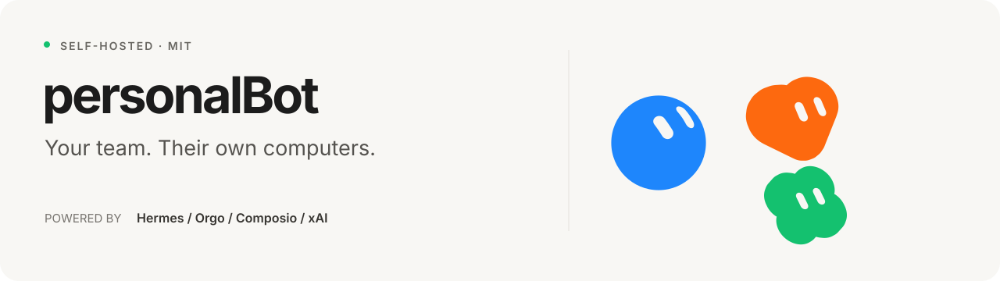
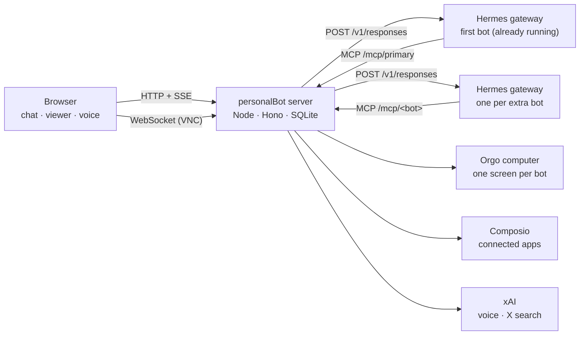

<p align="center">
  
</p>

<p align="center">
  A team of AI agents you chat with, each with its own screen on one cloud computer.<br>
  <a href="https://github.com/NousResearch/hermes-agent">Hermes Agent</a> runs the bots, <a href="https://orgo.ai">Orgo</a> gives them screens, <a href="https://composio.dev">Composio</a> connects their apps, and <a href="https://x.ai">xAI</a> gives them a voice and research on X.
</p>

<p align="center">
  <a href="#what-you-get">What you get</a> ·
  <a href="#how-it-fits-together">How it works</a> ·
  <a href="#install-on-the-computer">Install</a> ·
  <a href="#run-it-locally">Run locally</a> ·
  <a href="docs/ARCHITECTURE.md">Architecture</a> ·
  <a href="#status-and-limits">Limits</a>
</p>

<p align="center">
  
  
  
</p>

<p align="center">
  <picture>
    <source media="(prefers-color-scheme: dark)" srcset="assets/screenshots/chat-dark.png">
    
  </picture>
</p>

> **Fork notice.** personalBot is a fork of [Bot HQ](https://github.com/nickvasilescu/bot-hq) by Nick Vasilescu, under the same [MIT license](LICENSE). See [License and credits](#license-and-credits).

---

Give a bot a job, connect the apps it needs, and follow its work in chat. Each bot has a name, a look, its own memory, and a screen you can watch or take over. Bots can message each other, run recurring tasks, and talk with you over voice.

The interface is modeled on Grok Bot. Underneath, every bot is a Hermes agent, so it can run on the model subscriptions you already pay for (Claude, ChatGPT, Grok and others) or on API keys.

## What you get

| | |
|---|---|
| **Chat that shows the work** | While a bot works you see what it is doing right now, how long it has been at it, and each step it took. Finished turns fold into a "Worked for 2m 10s · 7 steps" chip you can open. |
| **A screen per bot** | Every bot has its own desktop on the shared computer. Watch it live in the side panel, open it full size, or take control with your own mouse and keyboard. |
| **Your existing Hermes agent, kept as it is** | The first bot is the Hermes agent already running on the computer. Its messaging channels, skills and memory keep working; the app only calls its API. |
| **Connected apps with approvals** | Bots ask for the app they need and you connect it through Composio. Actions that write (send, post, delete) wait for your OK on a card in the chat. |
| **Model and subscription per bot** | Pick the provider and model in the bot's Engine panel, or sign in to a subscription on the bot's own screen. |
| **Voice** | Talk to a bot with xAI's realtime voice modes. Real work is handed to the same bot, with the same memory and tools. |
| **Research on X** | Every bot has an `x_search` tool, backed by xAI. |
| **Routines, tasks and a Library** | Recurring jobs on a schedule, a task list per bot, and a place where bots save the files they make. |

<table>
  <tr>
    <td width="50%"></td>
    <td width="50%"></td>
  </tr>
  <tr>
    <td align="center"><sub>Watching a bot's screen live</sub></td>
    <td align="center"><sub>Each screen is dressed as that bot's own computer</sub></td>
  </tr>
</table>

<sub>The chat screenshot at the top uses the sample data built into the dev server (add <code>?fixtures</code> to the URL). The two above are from a running install.</sub>

## How it fits together



- **One computer, one screen per bot.** All bots live on a single Orgo Linux computer. The first bot uses the computer's main screen; each further bot gets an Orgo screen of its own. Orgo allows four screens per computer, so four bots.
- **The first bot is the Hermes agent that already runs on that computer.** The app talks to its gateway and never restarts it or rewrites its settings.
- **Every other bot gets its own Hermes home and gateway**, started by the app. Each has its own model, sign-in, memory, browser profile and files.
- **The app's tools reach Hermes over MCP.** The server exposes `/mcp/<bot>`. Each agent gets connected apps, `x_search`, tasks, routines, the Library, and messages to other bots.
- **Screens are dressed to look like the bot's own computer**: a light desktop with a dock, and a home screen with the bot's name and apps as Chrome's new tab page.

More detail is in the [architecture guide](docs/ARCHITECTURE.md).

### How this relates to Hermes Bot Mode

Hermes Desktop has its own Bot Mode. personalBot uses the same Hermes engine but does **not** use Bot Mode: it has its own bot layer on top of the gateway's HTTP API.

| | personalBot | Hermes Bot Mode |
|---|---|---|
| A bot is | A separate Hermes home (the first bot is the default profile) | A Hermes profile |
| Gateways | One per extra bot | One, serving every profile |
| Transport | HTTP, `/v1/responses` | JSON-RPC over WebSocket |
| Routines | The app's own scheduler | Hermes cron jobs |
| Bot to bot | The app's `send_to_bot` tool | Hermes' `message_agent` tool |

So bots made here do not show up in Hermes Desktop's Bots tab, and bots made there do not show up here.

## Install on the computer

The app is meant to run on the same Orgo computer as Hermes.

1. On your machine: `npm ci && scripts/pack.sh hq-app.tgz`. Copy `hq-app.tgz` and `scripts/install-on-computer.sh` to the computer.
2. In Orgo, create a public URL for port `8787` on that computer.
3. On the computer, as root:

   ```bash
   PUBLIC_URL=https://<name>.orgo.dev ORGO_COMPUTER_ID=<uuid> ALLOWED_EMAILS=you@example.com \
   KEYS_FILE=/root/keys.txt PRIMARY_CDP_URL=http://127.0.0.1:9333 \
     bash install-on-computer.sh hq-app.tgz
   ```

   `KEYS_FILE` holds `XAI_API_KEY=` and `COMPOSIO_API_KEY=` lines (and `ORGO_API_KEY=` if Hermes' own `.env` has none); it is deleted after the first install. `PRIMARY_CDP_URL` is only for a main agent that already has its own Chrome. The script installs to `/opt/hq`, adds one supervisor program (`hq-app`), and leaves Hermes alone. Running it again with a newer `hq-app.tgz` upgrades the app and keeps its settings and data.
4. Give the main agent the app's tools: `python3 /opt/hq/app/scripts/add-hq-to-hermes.py`. It adds one `mcp_servers.hq` entry to Hermes' `config.yaml`, keeps a dated copy of the file, and Hermes picks the change up without a restart. `--remove` takes it out again.
5. Open the public URL and sign in with Google. If Google sign-in is not set up yet, `bash /opt/hq/app/scripts/sign-in-link.sh you@example.com` on the computer prints a one-time sign-in link.

<details>
<summary><b>Remove everything</b></summary>

On the computer:

```bash
python3 /opt/hq/hq-screen.py undress 99                      # main screen back to how it was (99 = its X display)
python3 /opt/hq/app/scripts/add-hq-to-hermes.py --remove     # take the tools out of Hermes
supervisorctl stop hq-app && supervisorctl remove hq-app
rm -rf /etc/supervisor/conf.d/hq-app.conf /opt/hq /var/log/hq /root/grokbot /etc/opt/chrome/policies/managed/hq.json
```

Then delete the public URL in Orgo. Screens of the other bots are released when you delete those bots in the app.

</details>

## Run it locally

You need **Node.js 22 or newer** and a Hermes gateway with its API server on (`API_SERVER_KEY` in `~/.hermes/.env`).

```bash
git clone https://github.com/horelvis/personal-bots.git
cd personal-bots
npm ci
cp .env.example .env      # fill in the keys; comments in the file explain each one
npm run dev -w server     # API on :8787
npm run dev -w web        # app on :5173
```

With `HQ_LOCAL=0` the server reaches the computer through the Orgo API instead of running commands on it, which is enough for development. `DEV_LOGIN=1` enables the email-only sign-in form; never set it on a public address.

`npm run build && npm start` serves the built app from the API port.

### Without Orgo: screens in a local container

Set `HQ_BOX=docker` and the bots' screens run in one Linux container on your machine, under any Docker-compatible runtime (Colima, OrbStack, Docker Desktop). `ORGO_API_KEY` and `ORGO_COMPUTER_ID` are then not needed.

```bash
brew install colima && colima start --cpu 2 --memory 4    # or start the runtime you already have
echo 'HQ_BOX=docker' >> .env
npm run dev -w server
```

The server builds the image (`server/box/docker/`) on first use, which takes a few minutes, and starts the container `hq-box` when a bot needs its screen. What to know:

- Up to four screens, one X display each, dressed like on Orgo. The live viewer, **Take control**, the screen preview and the Library work the same.
- The browser is Chromium (there is no Chrome for Linux on arm64).
- Ports are published on `127.0.0.1` only: VNC on 59099-59102 (password-protected; the password is derived from `SESSION_SECRET` and never stored in the container's configuration), DevTools on 9299-9302. The container has a network of its own, so other containers cannot reach them.
- DevTools has no authentication: any program running on your machine can drive the bots' browsers through those ports, as the agents do. Do not use this mode on a machine you share with people you do not trust.
- Browser profiles and Library files live in the volume `hq-box-data`; the container itself can be removed at any time (`docker rm -f hq-box`). The server replaces it by itself when the image sources or its settings change.
- Deleting a bot stops its screen.
- Only the screens and browsers are in the container. The Hermes agents still run on your machine, so their shell commands act on it. The first bot is your existing agent: point its browser at `http://127.0.0.1:9299` in its own Hermes config if you want it to browse on its screen.
- **Sign in to a subscription** from the Engine panel is not available in this mode (it opens a terminal on the machine the agent runs on).

The keys you need:

| Key | Used for |
|---|---|
| `ORGO_API_KEY`, `ORGO_COMPUTER_ID` | The computer and its screens |
| `COMPOSIO_API_KEY` | Optional. Connected apps and event routines. It must be a project API key (`ak_...`) with full access; without it the app runs with connected apps switched off |
| `GOOGLE_CLIENT_ID`, `GOOGLE_CLIENT_SECRET` | Optional. Sign in with Google through your own OAuth client (see below) |
| `XAI_API_KEY` | Voice and `x_search` |
| `SESSION_SECRET` | Sign-in sessions and the tokens agents use to reach `/mcp` |

## Sign-in

Three ways in, each independent of the others:

- **Your own OAuth client (recommended).** Create an OAuth client of type *Web application* in Google Cloud, add `<SERVER_URL>/api/auth/google/callback` as an authorized redirect URI, and set `GOOGLE_CLIENT_ID` and `GOOGLE_CLIENT_SECRET`. The app asks Google only for `openid email profile` and accepts only a verified email.
- **Through Composio.** With `COMPOSIO_API_KEY` set and no Google client, sign-in uses a Composio-managed Gmail connection, as before.
- **Without Google.** `DEV_LOGIN=1` on a local machine, or a one-time link from `scripts/sign-in-link.sh`.

`ALLOWED_EMAILS` limits who can create an account with any of them.

Providers are declared in `server/src/oauth/providers.ts`. Adding one (GitHub, Microsoft...) is one entry there: its endpoints, the scopes that identify a person, and how its profile answer maps to an email. An entry can also say that the provider wants PKCE, takes the client secret in a Basic header, or needs more than one call to find a verified email. It is offered on the sign-in screen as soon as `<ID>_CLIENT_ID` and `<ID>_CLIENT_SECRET` are set. Each provider also lists its *services* with the scopes they need. Sign-in keeps no tokens.

### Gmail and Google Calendar with your own Google client

With `GOOGLE_CLIENT_ID` and `GOOGLE_CLIENT_SECRET` set, **Connect Apps** shows a Google section with Gmail and Google Calendar. Connecting one sends you to Google's consent screen for that service's scopes (`gmail.readonly` and `gmail.send`; `calendar.events`) and uses the same redirect URI as sign-in. In Google Cloud, enable the Gmail API and the Google Calendar API for the project, and add those scopes to the consent screen. While the project is in *Testing*, only its test users can connect.

Every bot then has these tools:

| Tool | What it does | Asks first |
|---|---|---|
| `gmail_search`, `gmail_read` | Search mail with Gmail's search syntax; read one message | no |
| `gmail_send` | Send an email, or reply inside a thread | yes |
| `calendar_list_events` | Events of the primary calendar in a range | no |
| `calendar_create_event`, `calendar_update_event`, `calendar_delete_event` | Create, change or delete an event; attendees are notified | yes |

The ones that ask first post the same approval card as connected-app writes (**Allow**, **Always allow**, **Don't allow**). Tokens are stored encrypted with a key derived from `SESSION_SECRET` and never reach the browser or the agents; changing `SESSION_SECRET` means connecting again. Disconnecting the last Google service hands the grant back to Google.

To add another service, add it to `services` in `server/src/oauth/providers.ts` and give the bots tools for it (see `server/src/agent/google-tools.ts`).

## Models and subscriptions

Open a bot's details panel, **Engine**. Pick a provider and model there. **Sign in to a subscription** opens a terminal on the bot's screen running Hermes' own sign-in for that provider (for example Claude Pro/Max), so you finish it in the viewer and the bot uses that subscription from then on. Check your provider's terms before running an agent on a consumer subscription.

## Development

```bash
npm run typecheck       # server and web
npm test                # unit tests (server)
python3 web/scripts/gen-avatars.py   # cut the character avatars again from the artwork in avatars/
npm run build
node tests/e2e.mjs https://<your-url>    # needs DEV_LOGIN=1, or E2E_SESSION=<session cookie>
```

The e2e suite creates a temporary bot (with its own Hermes gateway and screen), exercises chat, the browser on its screen, the live viewer, connected apps, voice sessions and settings, then deletes it. It calls real providers.

```text
server/src/         API, Hermes adapter (agent/loop.ts), engines (engine.ts), MCP endpoint (mcp.ts), screens (computer.ts)
server/box/         what runs on the computer to dress a screen (desktop, dock, home screen, Chrome)
web/src/            chat, bot settings, app connections, computer viewer, voice
scripts/            pack, install, Hermes config helper, sign-in link
tests/              Playwright end-to-end test
docs/               architecture; the Orgo and xAI/Composio guides predate the Hermes engine
```

## Status and limits

- Experimental, no security audit. Bots share one computer and can reach each other's files there.
- Approval cards cover Composio write actions. What a bot does through its browser or shell is not gated, and Hermes' own "risky command" prompts are not shown in the app yet.
- Four bots at most, because of Orgo's four-screen limit.
- Some internal names still say "grokbot" (the database file, cookies, folders on the bots' computer). Nothing a user sees does.
- The screen look is an original implementation inspired by OrgoAI/bops; no code or assets from that repository are used.

## License and credits

personalBot is a fork of [Bot HQ](https://github.com/nickvasilescu/bot-hq) by Nick Vasilescu and is distributed under the same [MIT license](LICENSE), with the original copyright notice kept. The bot artwork and some icons come from Grok Bot's design and remain the property of their owners, as do third-party app logos; the MIT license does not cover them. See [third-party notices](THIRD_PARTY_NOTICES.md).

Bot HQ itself continues [grokbot-clone](https://github.com/nickvasilescu/grokbot-clone). Built with [Hermes Agent](https://github.com/NousResearch/hermes-agent), [Orgo](https://orgo.ai), [Composio](https://composio.dev), and [xAI](https://x.ai). This is an independent project, unaffiliated with xAI, Cursor/Anysphere or Nous Research.
